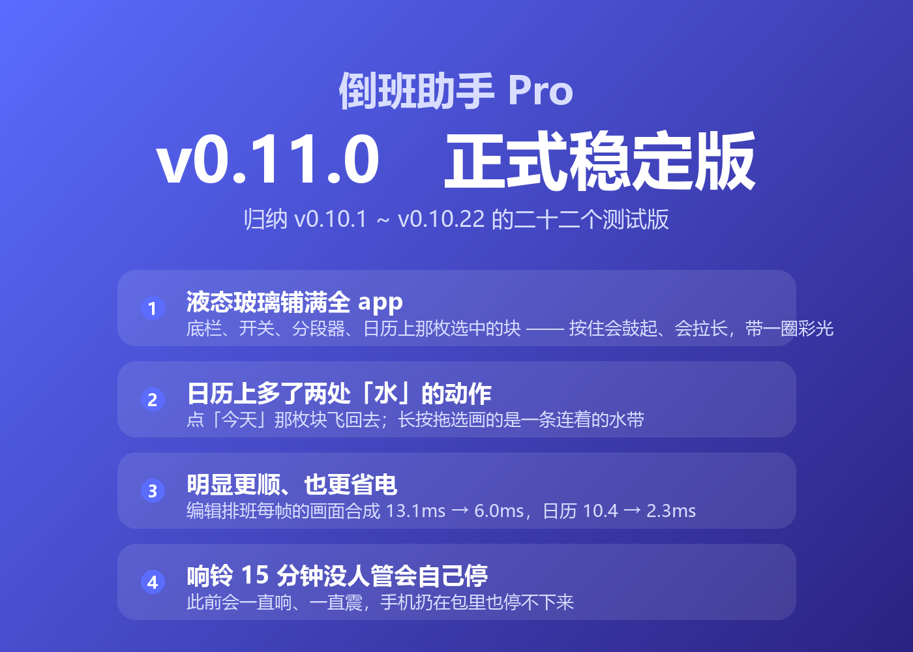
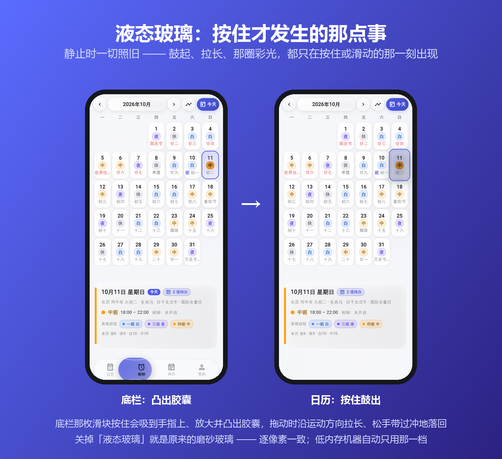
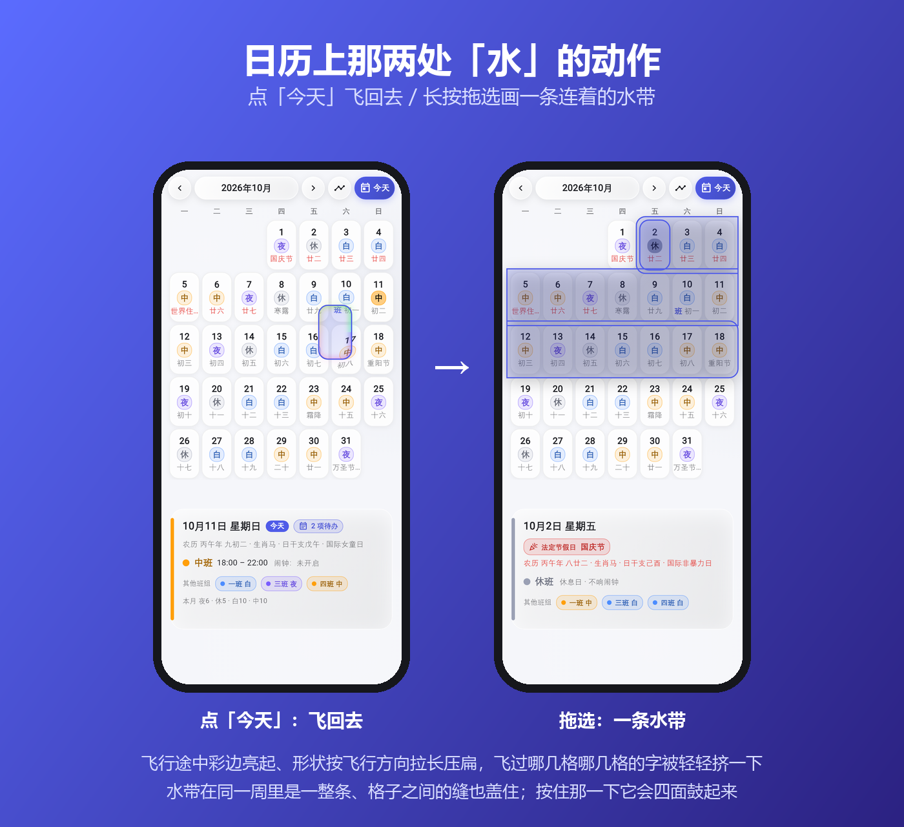
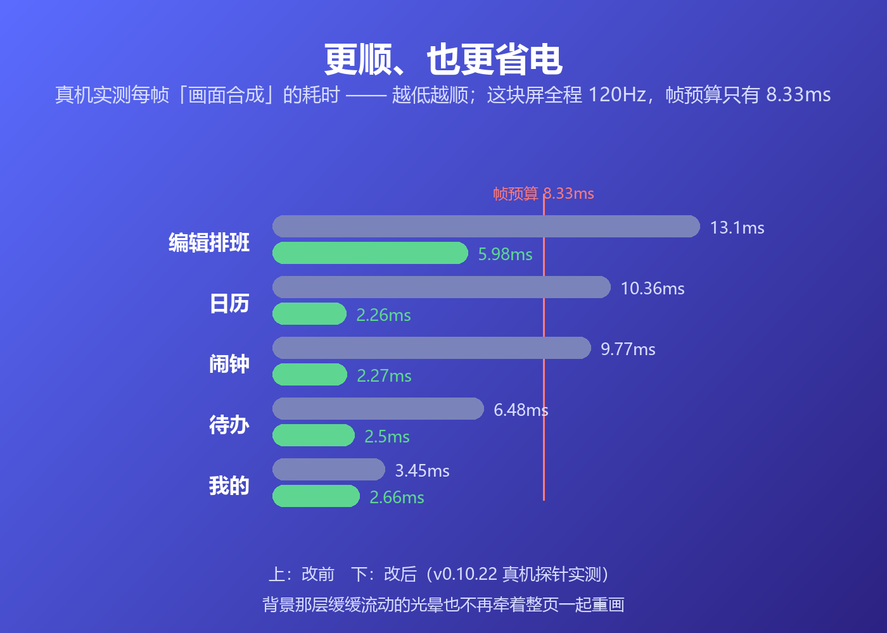
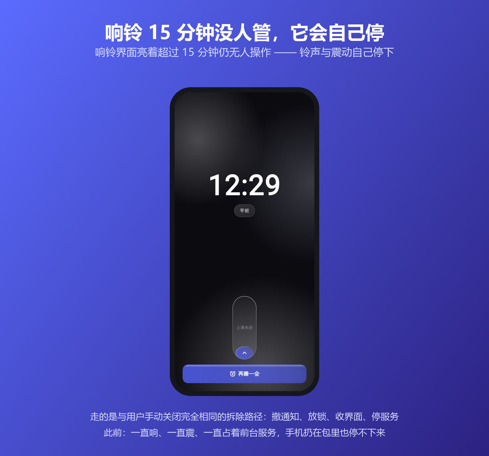

v0.11.0 正式版发了（归纳 0.10.1 ~ 0.10.22 二十来个测试版）。跟上一个正式版比，主要这几处 👇

- **液态玻璃铺满全 app**：底栏那枚滑块按住会吸到手指上、放大并凸出胶囊，拖动时沿运动方向拉长、松手带过冲地落回，边缘一圈彩色折射光；分段器、开关、日历上那枚选中的块也都是同一套玻璃 —— 按住四面鼓出来、底下浮起一层影子，那圈彩光一动就亮、停下就没了。关掉这一档就是原来的磨砂玻璃（逐像素一致）
- **日历上多了两处「水」的动作**：点别的日期再点「今天」，那枚块是一路飞回去的（途中彩边亮起、形状按飞行方向拉长压扁）；长按拖选一段日子，画的是一条连着的水带（同一周里一整条、格子之间的缝也盖住）
- **明显更顺、也更省电**：编辑排班页每帧的合成开销 13.1ms → 6.0ms、日历 10.4 → 2.3ms、闹钟 9.8 → 2.3ms、待办 6.5 → 2.5ms。背景那层缓缓流动的光晕以前会牵着整页一起重画，现在你按住拖动、翻月的时候它会先停一下、松手接着走
- **响铃 15 分钟没人管会自己停**：此前会一直响、一直震，手机扔在包里也停不下来
- **一批评测反馈的修复**：调完某一天的班次、或者换语言之后桌面小组件不跟着变，改完周期信息卡那行「本月统计」还是旧数字，拨一下触觉开关会把整个界面重建一遍，弹窗会顶进状态栏 / 手势条（21 个弹窗都受影响），底部弹层往下拖着要关掉时被压暗发糊，拖着日历上的块跨月换页会当场报错……

图在下面 👇

---

<!--
  下面是配图，发帖时按顺序传上去（文件名对应 docs/images/ 里的图）：

  1. v0110-cover.png       封面
  2. v0110-liquid.png      液态玻璃：底栏滑块按住提起成透镜 / 开关按住拉长（两屏）
  3. v0110-calendar.png    日历上那两处「水」的动作：飞回去 + 拖选水带（两屏）
  4. v0110-smooth.png      更顺更省电：前后数字对比
  5. v0110-alarm-stop.png  响铃 15 分钟没人管会自己停

  正文只列「多了哪几件事」，每件事的「以前怎样、现在怎样」在图里 —— 评论区
  装不下长文案。要更全的版本（含完整修复清单、已知限制、SHA256）见 GitHub
  Release 的发布说明。

  动图另出（酷安支持 GIF，发帖时和上面几张一起传）。它们**不入库**，产物在
  work/gif/ 下，由 `flutter test tool/gif/render_gifs_test.dart` 逐帧出图 +
  `python scripts/make_gif.py` 合成：
    work/gif/v0110-nav-drag.gif      底栏滑块按住拖动（透镜凸出 + 沿速度拉伸 + 彩边）
    work/gif/v0110-switch-drag.gif   开关按住拖动（拉长 + 轨道色跟着走）
    work/gif/v0110-cal-flight.gif    点「今天」飞回去
    work/gif/v0110-cal-band.gif      长按拖选那条水带
-->

