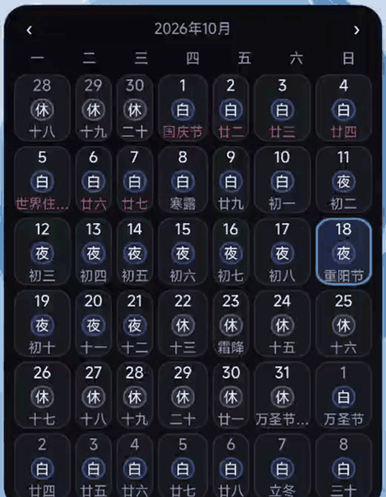
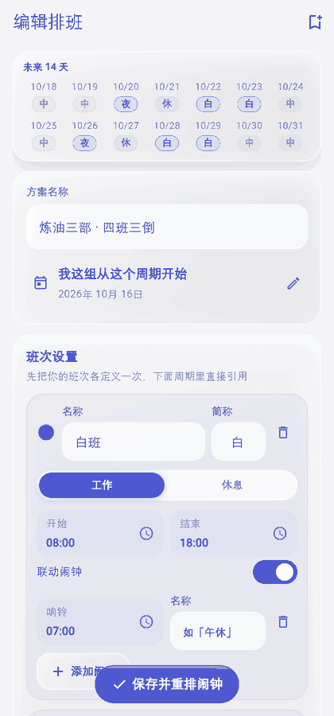
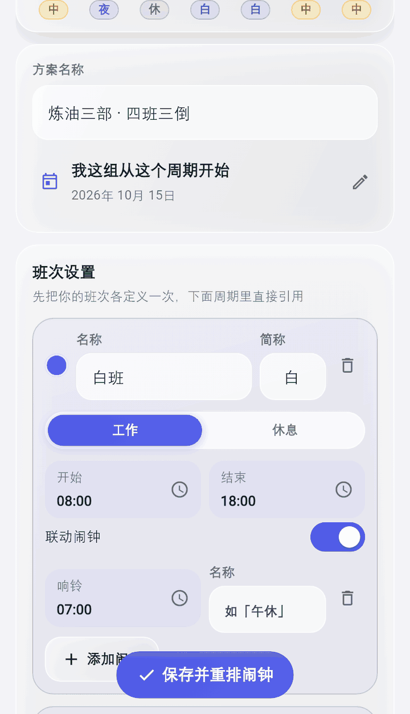
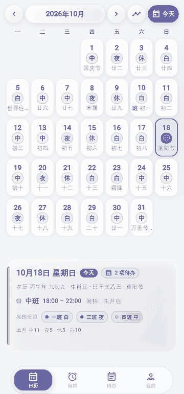
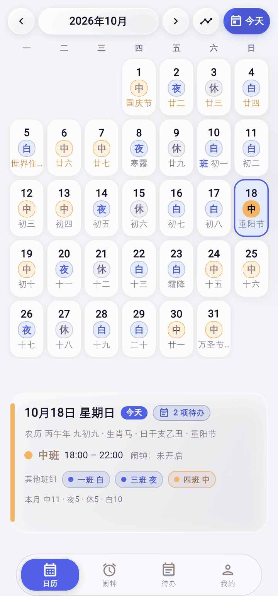
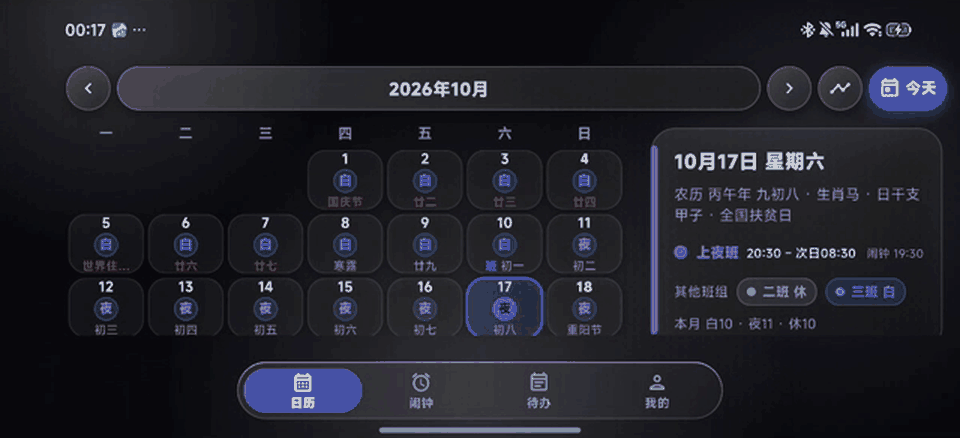

v0.12.0 正式版发了（归纳 0.11.1 ~ 0.11.26 二十六个测试版）。跟上一个正式版比，主要这几处 👇

**桌面小组件终于跟 App 长得一样了**：今日卡补齐了班次备注、「其他班组」和「本月统计」，最左边那条主色竖条通到卡片底；月历「今天」换成 App 同款的半透明块，周标题改单字，班次胶囊按文字宽窄现量；三张卡的字号都不再跟系统字号走 —— 系统调到 200% 也不会把卡里的字撑破。翻月、回今天都在标题行上。

**按月排班**：有些人的班表不是固定轮转，而是每月 1 号重新开始的一套切法 —— 编辑排班最上面切到「按月」，按段指定「每月第 N 天起上什么班」，可加可删；多班组按段错开。老的周期排班一点没变。

**班次颜色 16 种 + 自定义取色**：颜色盘里 16 颗现成色，不够用就自己调 —— 色相条 + 饱和度/明度方盘 + 十六进制输入，下面两颗真的日历小样当场告诉你这个颜色在浅色卡、深色卡上长什么样。

**待办自动归档**：勾完的收进列表底部「已完成 N 条」，主列表只留没做的；一次性待办在归档里再点一下勾就能拿回来，刚勾错时提示条上也有「撤销」。

**字号四档**：「我的 → 外观 → 字体大小」，小 / 标准 / 大 / 特大，App 自己管、不跟系统字号走。切到「特大」日历顶栏年月会折行、底栏信息卡跟着长高，格子里的字始终归一到格子里，绝不省略。

**横屏两栏**：横屏、平板与车机上日历自动变成左右分栏 —— 左边日期网格、右边当天信息，日期格不再被压扁。

**底部弹层的统一头部**：把手 + 主色竖条标题 + 分隔线，按住往下一拉就能关。这一版还把小节标题、空态、加载态、卡片与列表行的按压反馈各收成一套。

**其他更新**（一屏说完）

- 闹钟落点扩到**三档**：前一天 / 当天 / 次日，按上班时间算，列表逐条写明；每个班次的闹钟上限 6 → **10 条**
- 贪睡时长可选 1 / 5 / 10 / 15 / 20 / 30 分钟，响铃按钮上直接写着会睡多久
- 桌面小组件：能翻前后各三个月、点标题回今天；周条与月历同步（半透明「今天」块、单字周标题、胶囊按文字宽）
- 状态栏图标跟着主题档走：浅色档进「排班管理」不再变成白图标、退回来也会恢复
- 输入框的名字改写在框的上方 —— 真机字体下不再被压成半截
- 实心主色面上的字一律白字，压深改成「刚够读清就停」：默认蓝不再被压成近黑
- 底部导航那圈彩色光晕的接缝修好了（右边不再有一刀切）
- 使用帮助改成两层：一级是功能简介，二级按「我想办一件事 / 它不对劲」分两组，三十来条
- 编辑排班的「每月第 N 天起」不再出现省略号；排班管理页的主操作落到屏幕底部
- 待办勾选后的「撤销」在切走再切回来之后也仍然有效（此前只会收掉提示条、那条待办不恢复）
- 一批真机反馈的收口：弹窗按钮靠右、编辑排班的保存胶囊浮到正文上、小窗下的帮助与标签、日历格子上那个「有闹钟」的小点去掉……

装完新版记得**先打开一次 App**，桌面小组件才会重画成最新数据。

图在下面 👇

---

<!--
  配图说明（发帖时按顺序传，文件名是 `dist/coolapk/` 里的编号版）：
  0. 00-update-cover.png   封面
  1. 06.6-v0120-widget.gif   桌面小组件翻月（真机录屏，慢放）
  2. 06.3-v0120-monthly.gif  按月排班（工装，慢放）
  3. 06.2-v0120-color.gif    自定义班次颜色（工装，慢放）
  4. 07.2-v0120-archive.gif  待办自动归档（工装，慢放）
  5. 09.2-v0120-font.gif     字号四档（工装，慢放）
  6. 10.5-v0120-wide.gif     横屏两栏（真机录屏，慢放）
  7. 06.4-v0120-sheet.gif    底部弹层下拉关闭（工装，慢放）

  正文里的 `images/v0120-*.gif` 是 docs 里的同一批文件；`dist/coolapk/` 里是
  按主帖图序编好号的上传版。单张 0.45~0.9MB、6~10 秒。
  要更全的版本（完整修复清单、已知限制、SHA256）见 GitHub Release 的发布说明。
-->

