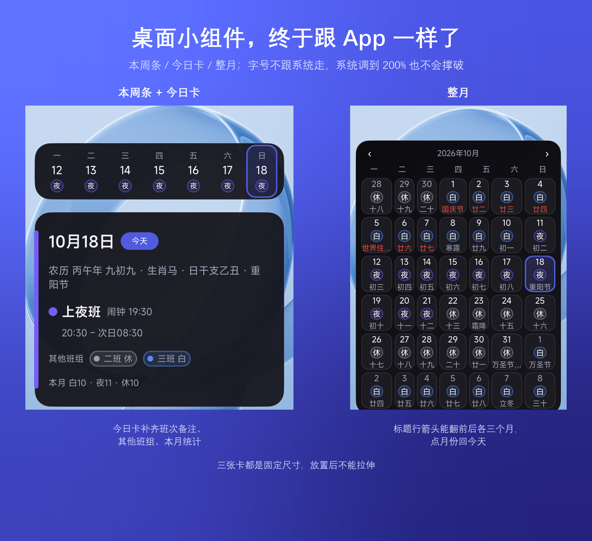
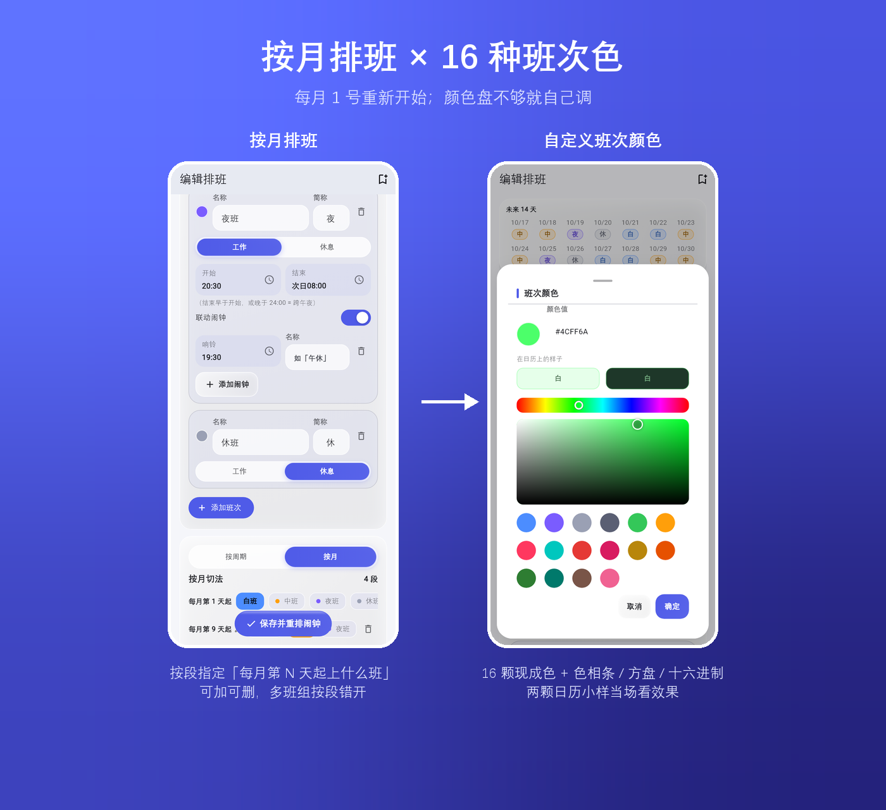
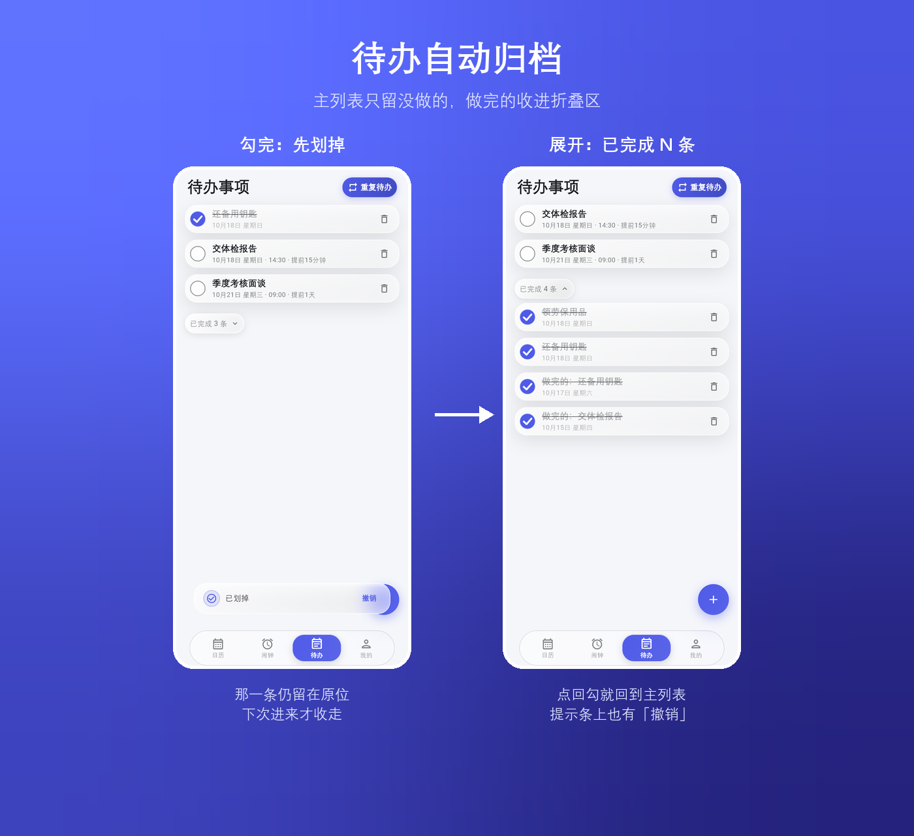
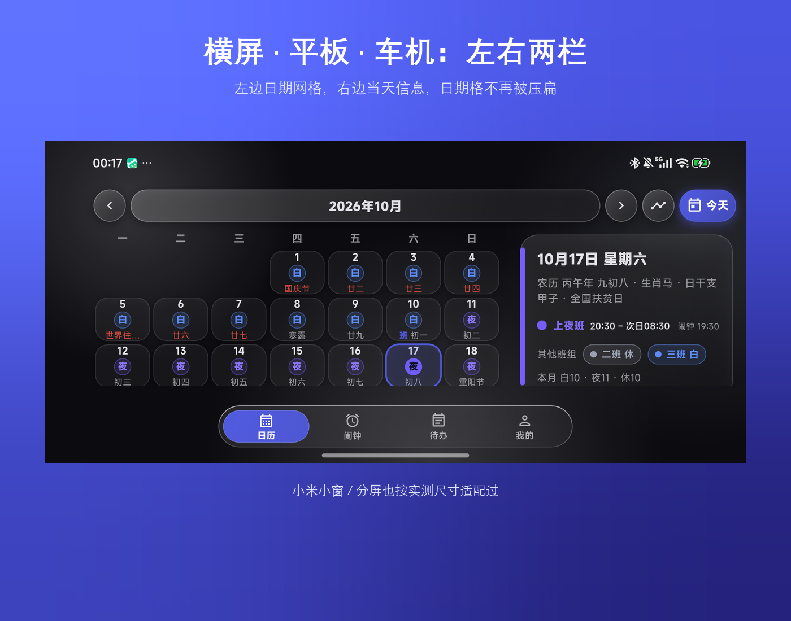

v0.12.0 正式版发了（归纳 0.11.1 ~ 0.11.26 二十六个测试版）。跟上一个正式版比，主要这几处 👇

- **桌面小组件贴齐 App**：今日卡补齐班次备注 / 其他班组 / 本月统计，最左边那条主色竖条通到卡底；月历「今天」换成半透明块、周标题改单字、班次胶囊按文字宽窄现量；三张卡的字号不再跟系统字号走
- **按月排班 + 16 种班次色**：每月 1 号重新开始的一套切法，段可加可删、多班组按段错开；颜色盘扩到 16 颗，也能自己调 —— 色相条 / 方盘 / 十六进制 / 两颗日历小样
- **待办自动归档**：做完的收进「已完成 N 条」，主列表只留没做的；一次性待办点回勾就回到主列表，刚勾错时提示条上也有「撤销」
- **字号四档 / 横屏两栏**：App 自己管字号，系统调到 200% 也不会把界面撑破；横屏、平板、车机上日历自动变成左右两栏
- **一批真机反馈的收口**：输入框标签、实心主色上的白字、底部弹层下拉关闭、使用帮助改成两层、闹钟落点三档 / 每班 10 条、贪睡时长可选……

图在下面 👇

---

<!--
  发帖时按顺序传（上传版在 dist/coolapk/update-post/）：
  00-cover.png      封面
  01-widget.png     桌面小组件
  02-schedule.png   按月排班 + 自定义颜色
  03-todo.png       待办自动归档
  04-wide.png       横屏两栏
  05-widget.gif     桌面小组件翻月
  06-monthly.gif    按月排班
  07-color.gif      自定义班次颜色
  08-archive.gif    待办自动归档
  09-font.gif       字号四档
  10-wide.gif       横屏两栏
  11-sheet.gif      底部弹层下拉关闭

  正文里引的是 docs/images/ 里的同一批文件；GIF 单张 0.45~0.9MB、6~10 秒。
-->

