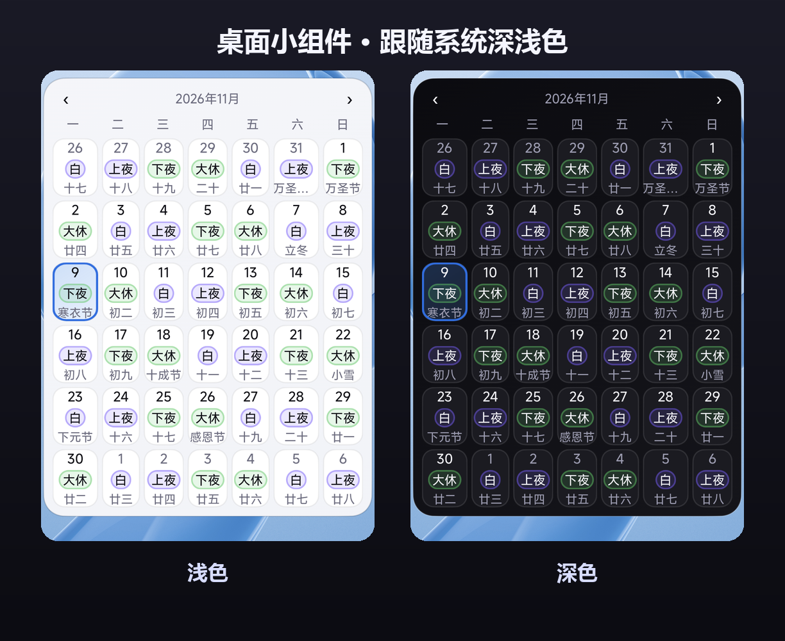
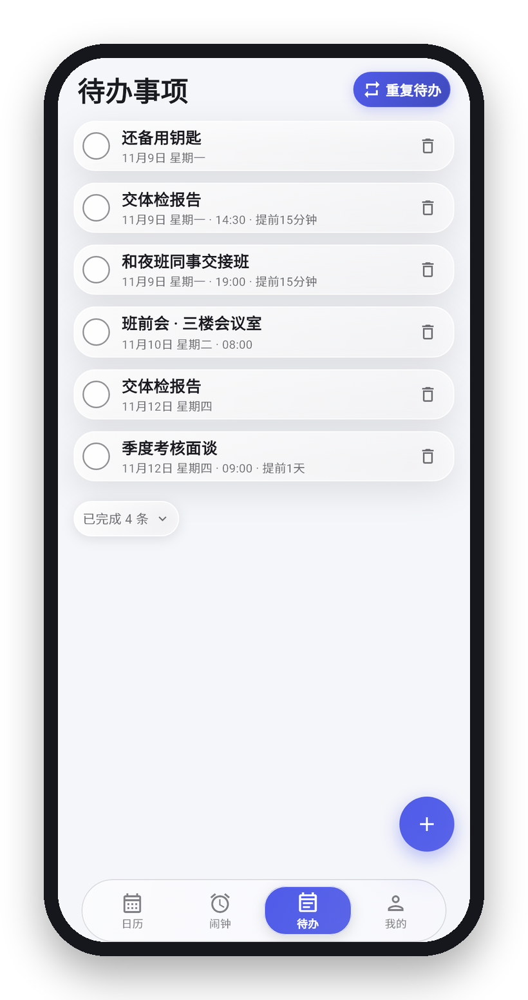
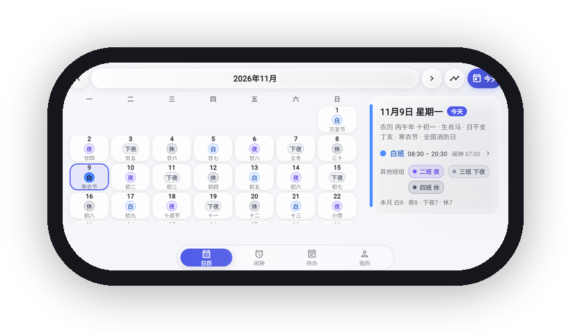
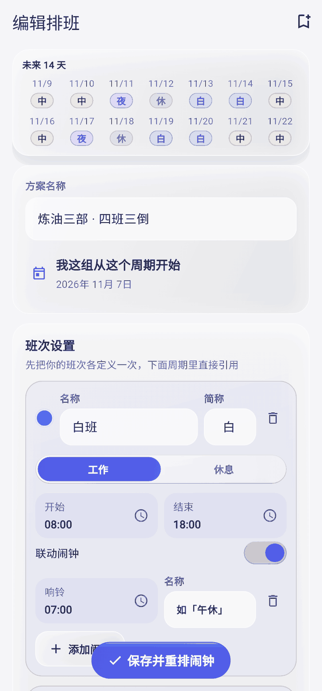
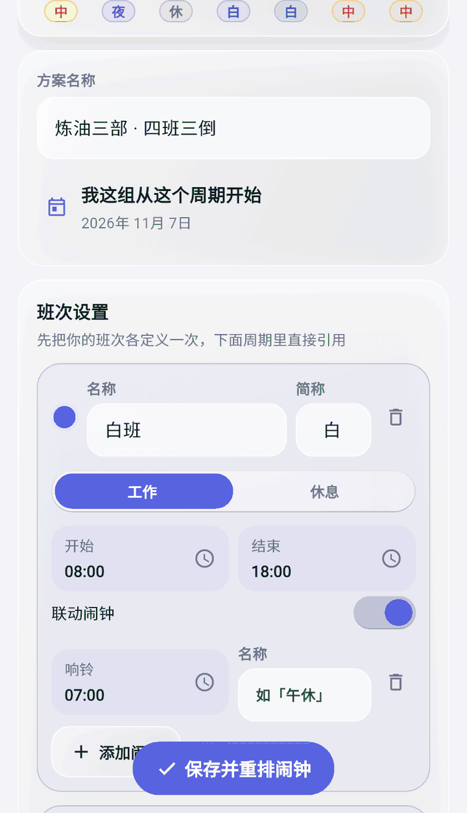
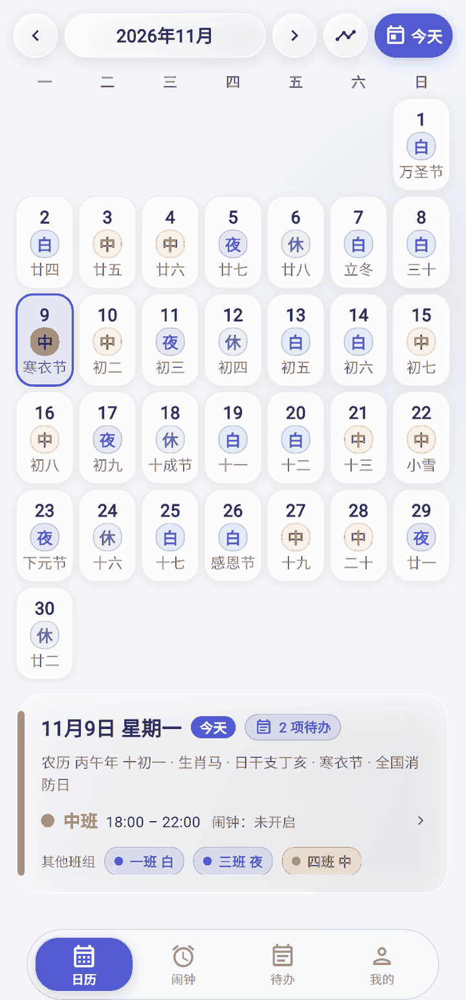
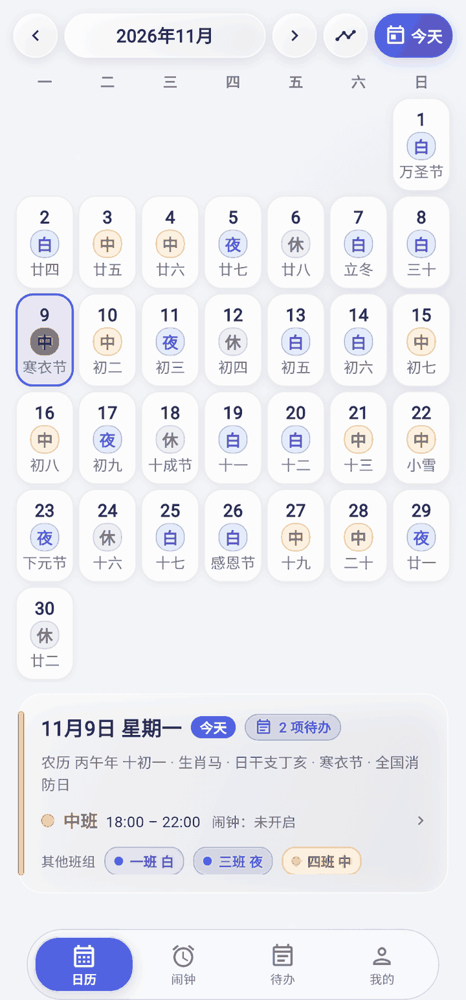
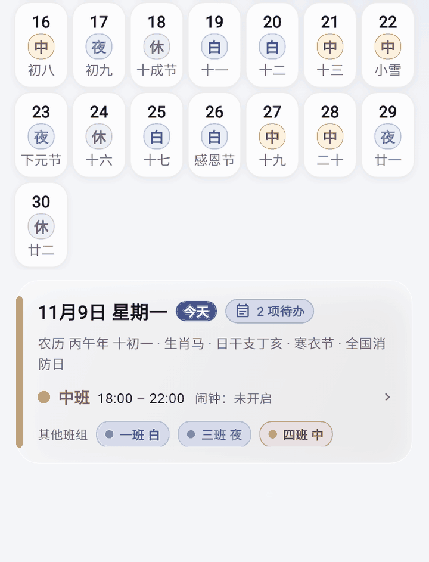

v0.13.0 正式版发了（归纳 0.12.1 ~ 0.13.0 十一个测试版）。跟上一个正式版比，主要这几处 👇

- **桌面小组件跟随系统深浅色**：App 里选「跟随系统」时，系统切到深色 / 浅色，三张卡当场换色 —— App 不在运行也变
- **重复待办收口**：可以按班次重复（上夜班 / 下夜班那天自动出现）、每月多选几天、随时改规则；跨午夜的行回到班次那天，副标题写「上夜班 · 次日 00:00」；勾掉 / 删掉后那一次不再响，撤销会回来；冷启动会重新排提醒
- **排班页更干净**：排班管理与编辑排班里的箭头去掉了，整行仍然可点
- **0.12 这一轮的底子**：按月排班、16 种班次色 + 自定义取色、待办自动归档、字号四档、横屏两栏
- 修：旧版跨午夜待办升级后可能少出现一次（旧水位线多一天），0.13.0 已修

图在下面 👇

---

<!--
  发帖时按顺序传（上传版在 dist/coolapk/update-post/）：
  00-cover.png        封面
  01-widget-theme.png 小组件跟随系统深浅色
  02-todo.png         待办 / 重复待办
  03-wide.png         横屏两栏
  04-monthly.gif      按月排班
  05-color.gif        自定义班次颜色
  06-archive.gif      待办自动归档
  07-font.gif         字号四档
  08-sheet.gif        底部弹层下拉关闭

  正文里引的是 docs/images/ 里的同一批文件；GIF 单张 0.9~4.6MB、7~11 秒。
-->

